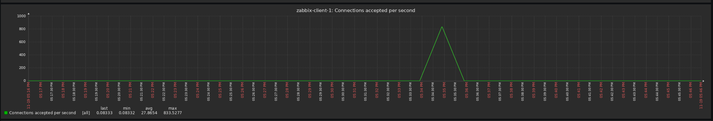
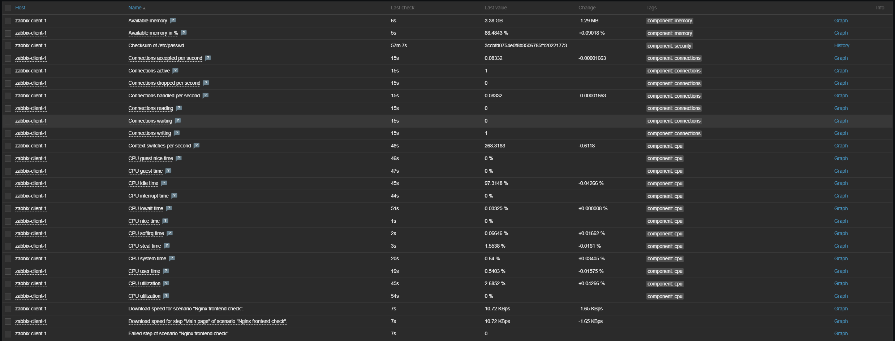

# Мониторинг Nginx в Zabbix 7.0 — лабораторная работа

Настроен полный цикл наблюдаемости (observability) веб-сервера Nginx:
сбор метрик через Zabbix Agent 2, валидация нагрузочным тестом, артефакты
для воспроизведения на любом хосте.

## Стек

- Zabbix 7.0 (сервер + Agent 2)
- Nginx (`stub_status`)
- Apache Bench (`ab`) — нагрузочный тест
- Bash, Git/GitHub

## Что сделано

- Включён эндпоинт `stub_status` в Nginx с ограничением доступа
  (`allow 127.0.0.1; deny all;`) — метрики не доступны извне.
- Развернут шаблон `Nginx by Zabbix agent`: 14 айтемов (Connections
  active/waiting/reading/writing, rate accepted/handled/dropped,
  Requests per second, Requests total, Version, Service status,
  Service response time), discovery-правило процессов Nginx с 6
  прототипами айтемов, 4 триггер-прототипа, 3 графика и дашборд
  «Nginx performance».
- Проведена валидация мониторинга нагрузочным тестом
  (`ab -t 120 -c 10`): всплеск `Connections accepted per second`
  до ~833 cps зафиксирован на графике, данные подтверждены в Latest data.

## Как воспроизвести (5 минут)

1. Импортируйте шаблон: Zabbix UI → Data collection → Templates → Import →
   `configs/zabbix/template.xml`.
2. Настройте Nginx: добавьте блок `location = /basic_status { stub_status;
   allow 127.0.0.1; deny all; }` в `server { ... }` файла
   `/etc/nginx/sites-available/default` и перечитайте конфиг:
   `nginx -t && nginx -s reload`.
3. Привяжите шаблон `Nginx by Zabbix agent` к хосту с Nginx.
   Макросы по умолчанию: `{$NGINX.STUB_STATUS.PATH}` = `basic_status`,
   `{$NGINX.STUB_STATUS.HOST}` = `localhost`, порт `80` — совпадают с конфигом.
4. Запустите нагрузку на хосте с Nginx (тест идёт на localhost, так как
   эндпоинт статуса закрыт от внешних запросов):

   ```bash
   chmod +x scripts/load_test.sh && ./scripts/load_test.sh
   ```

   (потребуется пакет `apache2-utils`: `apt install apache2-utils`).
5. Проверьте результат: график `Nginx: Connections per second` должен
   показать всплеск accepted-линии до ~833 cps; в Latest data все метрики
   должны собираться без ошибок.

## Артефакты

| Файл | Назначение |
|---|---|
| `configs/nginx/stub_status.conf` | Конфиг сайта Nginx с защищённым `stub_status` |
| `configs/zabbix/template.xml` | Экспортированный шаблон Zabbix (готов к импорту) |
| `scripts/load_test.sh` | Нагрузочный тест для валидации мониторинга |
| `assets/latest_data.png` | Скриншот Latest data с собранными метриками |
| `assets/graph_spike.png` | График со всплеском во время нагрузочного теста |

## Скриншоты




